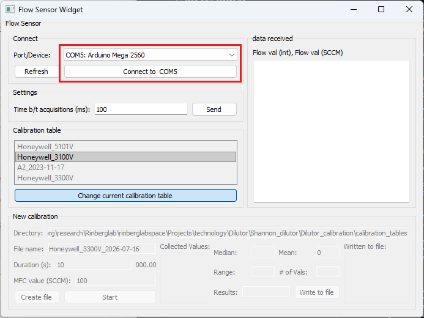
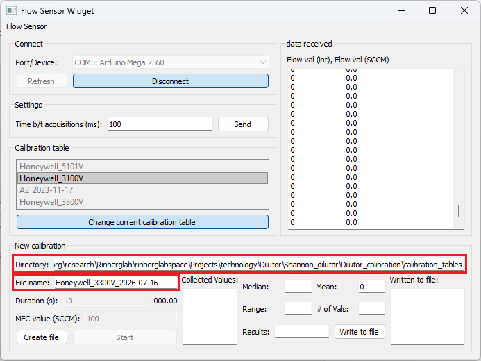
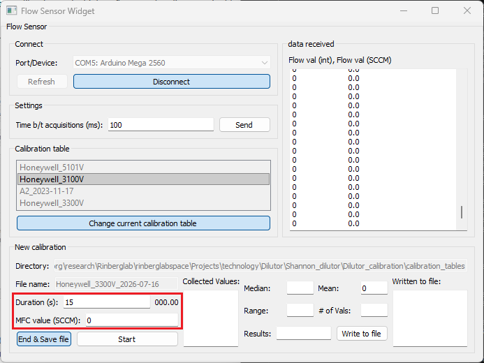
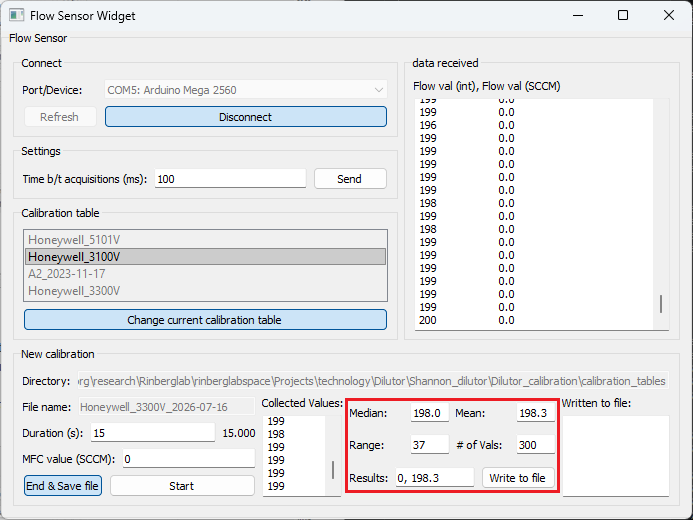

# Calibration procedure

## Setup

### Electronics
- Upload the script to the Arduino
- Connect the flow sensor to the Arduino and a constant 9V power supply. Make sure all 3 are grounded to each other
    - It is essential that the power supply to the flow sensor is stable. The flow sensor output is ratiometric to the supply voltage.

### Hardware
- Connect the flow sensor input to the exhaust line of the final valve
- Turn on the power to the flow sensor. Be sure to give it 1-5 min of warmup time before starting to record.
- Make sure the final valve is closed

---

# Calibrate

## Olfa MFC calibration
<!--Copied from OlfaControl_Electronics/../Flow_Sensor_Calibration_Protocol.md-->

1. Open both GUIs  
    - **Flow Sensor GUI**  
    - **Olfa Driver** 

### Create file
2. In the **Flow Sensor GUI**: Select the correct device from the dropdown menu and click **Connect**.

  

3. Confirm/edit the file directory if needed. Enter the desired file name.

  

4. Click **Create File**.

<!--
***Note:** Calibration tables **must** be in descending order, so it is recommended to start calibrating at the maximum capacity and work down from there. Otherwise, the table will need to be sorted manually after completing the calibration.*
-->

### Run calibration

5. In the **Olfa Driver GUI**:
    - Set both dilutor MFCs to 0 SCCM.
    - Set the main olfa MFC to the first desired calibration value (0).

6. In the **Flow Sensor GUI**:
    - Enter the main olfa MFC setpoint as **MFC value (SCCM)**
    - Enter the desired duration of the calibration as **Duration (s)** (10-15 seconds is typically sufficient)

  

7. Click **Start**

8. Once calibration at this flow rate is complete, stats about the flow sensor data collected during that period will populate the fields in the bottom right of the groupbox. By default, the values to write to the calibration files will display in the bottom-right box (*flow rate* [SCCM], *mean value* [integer]).  

  

9. **Check if the calibration was successful** by looking at the range of values collected from the flow sensor during the calibration. If the range exceeds 4, repeated trials are recommended.  

**Reminder**: For the main olfa MFC, confirm the actual setpoint by physically looking at the MFC. Write this setpoint to the file.

10. If the calibration was successful, click **Write** to write this pair to the calibration file. If necessary, you can also manually enter the values to write to the file. (Values already written to the file will be displayed in the far right box.)  

11. **Repeat for as many values as desired.** (I typically do 10sccm increments, to save time. For more sensitive experiments, 2-5 increments may be more helpful.)

 

### Once complete:
12. Click **End & Save File**

## Vacuum MFC calibration

13. Set the Main olfa MFC to 1000 SCCM
14. (Check that the Air MFC is still set to 0 SCCM)
15. Update the file name to "vacuum_calibration_thisdate" or whatever
16. Click **Create File**
17. Repeat steps 5-12 from the Olfa MFC calibration procedure (but with the vacuum MFC instead of the main olfa MFC)

## Air MFC calibration

18. Set the Main olfa MFC and Vacuum MFCs to 0 SCCM.
19. Update the file name to "air_calibration_thisdate" or whatever
20. Click **Create File**
21. Repeat steps 5-12 from the Olfa MFC calibration procedure (but with the air MFC instead of the main olfa MFC)
